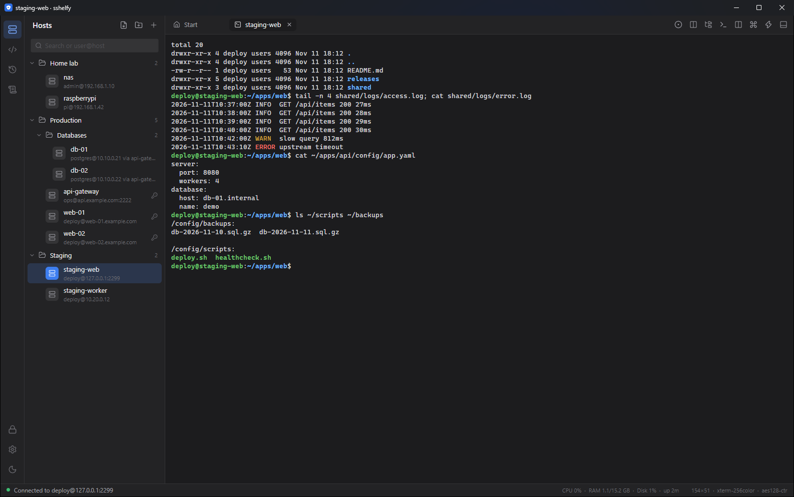
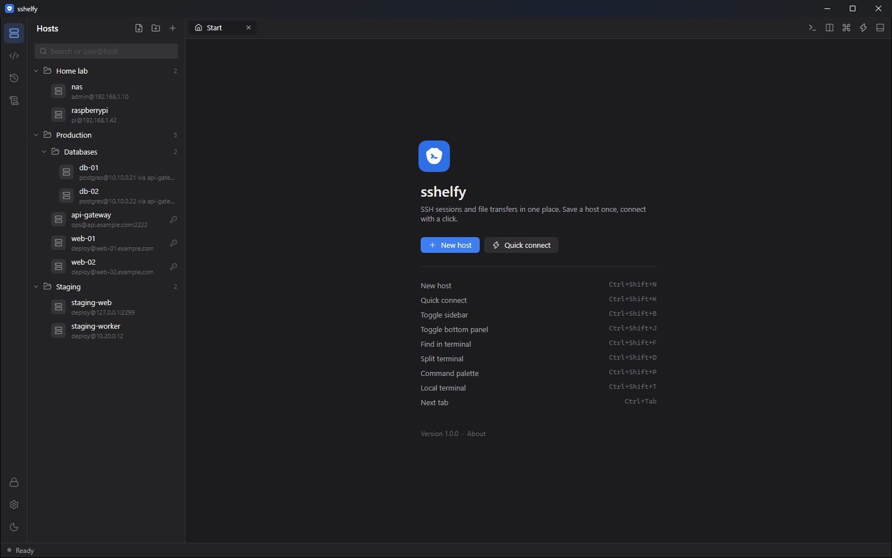
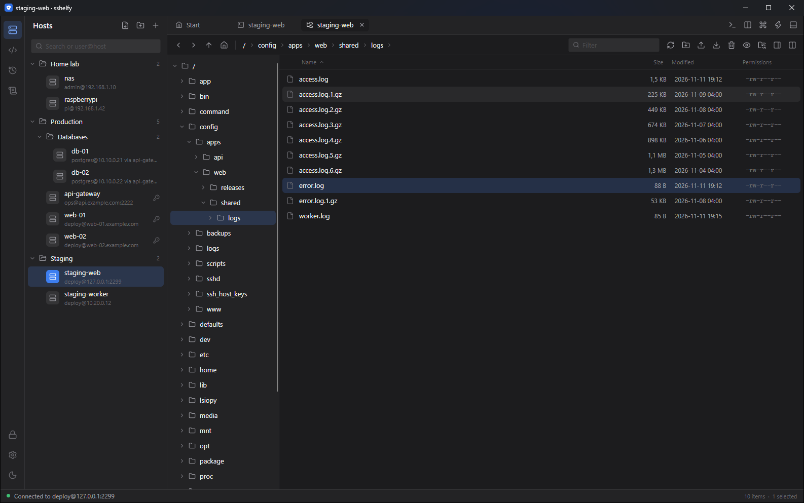
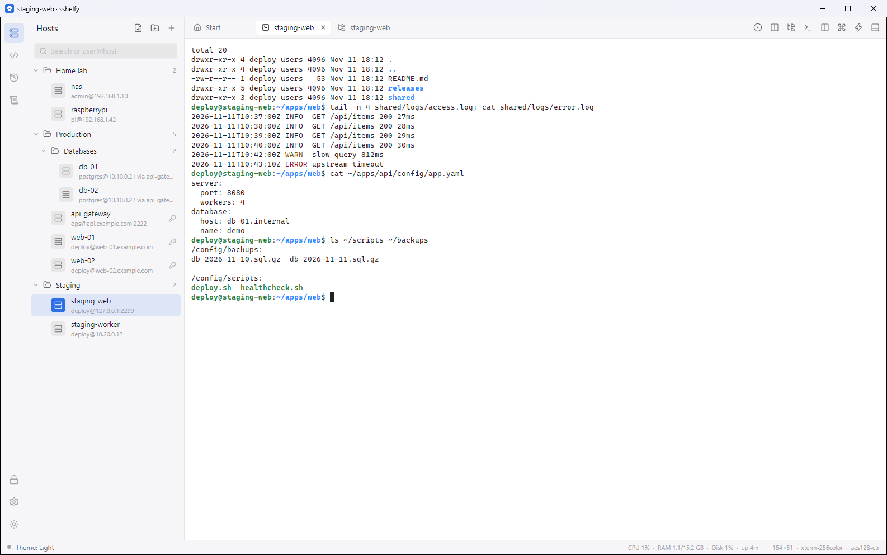

# sshelfy

[](https://github.com/sshelfy/sshelfy/actions/workflows/ci.yml)

A free, open-source desktop SSH and SFTP client for Windows and macOS, in the spirit of Termius and MobaXterm,
built with C#, .NET 10 and Avalonia UI.

**Download:** the latest version is on the [Releases](https://github.com/sshelfy/sshelfy/releases/latest) page.

- **Windows:** download `sshelfy-<version>-win-x64.exe` (a single file, no installer or .NET needed) or the `.zip`.
  The file is not code-signed yet, so Windows SmartScreen may say it "protected your PC": choose
  **More info → Run anyway**. You can compare the file with `SHA256SUMS.txt` from the same release.
- **macOS:** a packaged build is coming. Until then, run it from source (see [Building from source](#building-from-source)).

sshelfy collects no telemetry and talks to nothing but your servers, plus an optional check for new
releases on GitHub (can be turned off in Settings).



| Host list | SFTP browser | Light theme |
|---|---|---|
| [](docs/screenshots/hosts.png) | [](docs/screenshots/sftp.png) | [](docs/screenshots/terminal-light.png) |

## Features

- Host list with nested groups, search and quick connect (`user@host:port`)
- SSH terminal in tabs: xterm-256color, truecolor, alternate screen (vim, htop, less), mouse reporting, scrollback, selection, copy/paste, find (with regex), reflow on resize
- Server resources of the active session (CPU, memory, disk, uptime) in the status bar, read from /proc over a separate exec channel (Linux servers; can be turned off in Settings)
- Terminal color schemes: built-in (Dracula, Nord, One Dark, Tokyo Night, Catppuccin, Gruvbox, Monokai, Solarized, GitHub Light) or imported from Windows Terminal, iTerm2 (.itermcolors) and base16 files, with a live preview in Settings
- Highlight rules: regular expressions color matching terminal text (ERROR and WARN out of the box); a rule can notify when it matches in a background tab, and a long command finishing in the background is reported too (tab dot, status bar, taskbar flash)
- Images in the terminal: DEC sixel (img2sixel, chafa, lsix) and the iTerm2 inline image protocol (imgcat), scrolling with the text
- Saved layouts: the open tabs with their split panes saved under a name and reopened in one click (toolbar or command palette); reopening the last session keeps splits too
- SSH certificates: attach the "-cert.pub" signed by your CA to a key and it is presented at login; FIDO2 security keys (ed25519-sk, ecdsa-sk) can be imported and their sessions run in the Windows OpenSSH client, which asks you to touch the key
- Host session options (Session page of the host editor): a startup command run after login, environment variables exported before it, and the folder the file browser opens first
- Before connecting: a local command (e.g. bring up a VPN; a failure stops the connection) and a port knocking sequence (TCP and UDP) per host. Commands that were not typed in this app, such as ones from an imported backup, ask once before they run
- Edit server files in your own editor (VS Code, Notepad++… set in Settings, or the default app): every save is uploaded back while the SFTP tab is open, with a warning if the file changed on the server meanwhile
- Folder compare in two-panel SFTP mode: both folders are compared through all subfolders (size and time), newer or missing files are preselected and copied through the transfer queue; nothing is deleted
- File preview pane in the SFTP browser: text (the end of large files) and pictures of the selected file, with a live follow mode for growing logs (like tail -f)
- Clickable links in the terminal: URLs and OSC 8 hyperlinks are underlined on hover and open with Ctrl+click (or from the context menu)
- Local terminals (PowerShell, cmd, Git Bash, WSL distributions) in tabs via ConPTY, with the same features as SSH sessions
- Split panes with broadcast input (type into several sessions at once), automatic reconnect after a dropped connection
- Command palette (Ctrl+Shift+P) for hosts, snippets, recent commands and actions
- SFTP browser: folder tree + file list, two-panel mode (this computer next to the server, F5 / drag to copy), upload/download with progress, drag and drop from the OS, move by dragging onto folders, remote text editor, follows the terminal's current folder
- Import from `~/.ssh/config` (with Include, wildcards, IdentityFile, ProxyJump) and `known_hosts`
- Jump hosts (ProxyJump), including chains of several hops
- Port forwarding (local, remote, SOCKS) saved per host or added to a running session
- Password and private-key authentication (OpenSSH, PEM, PuTTY keys), keys shared between hosts; Ed25519/RSA key generation and one-click install into a server's authorized_keys
- SSH agent authentication: Pageant, the OpenSSH agent for Windows, or `SSH_AUTH_SOCK`; agent forwarding and X11 forwarding per host (the session then runs in the Windows OpenSSH client, since SSH.NET cannot open these channels; X11 needs a local X server such as VcXsrv or X410, display set in Settings)
- Encrypted vault for passwords and keys behind a master password
- Session recording: readable text or replayable asciicast, optional encryption with a vault key, size limit and retention
- Snippets with `{{variables}}` and per-host command history
- Activity log (connections, host keys, transfers, tunnels) and a diagnostic log
- Encrypted export / import of hosts, groups, keys, snippets and settings, with a preview and conflict choices
- Light and dark theme, IDE-style layout: activity rail, sidebar, tabs, bottom transfer panel, status bar

## Roadmap and changes

What is planned next: [docs/ROADMAP.md](docs/ROADMAP.md). What changed in each release: [CHANGELOG.md](CHANGELOG.md).

## Building from source

Requires the .NET 10 SDK (10.0.102 or newer).

```
dotnet run --project src/Sshelfy.App
```

To build an executable for everyday use and install it for your user (Start menu shortcut included):

```
powershell -ExecutionPolicy Bypass -File tools\publish.ps1
```

This produces a single self-contained `sshelfy.exe` (no .NET install needed) in `artifacts\sshelfy` and copies it to `%LocalAppData%\Programs\sshelfy`. Run the script again after changing the code to update; close sshelfy first. `-NoInstall` only builds, `-NoShortcut` skips the shortcut.

Data lives in `%AppData%\sshelfy` (macOS/Linux: the user config directory). Set `SSHELFY_DATA_DIR` to use a different folder, e.g. for testing, and `SSHELFY_SSH_DIR` to import from another folder than `~/.ssh`.

## Solution layout

| Project | Responsibility |
|---|---|
| `Sshelfy.Core` | Domain models and services with no UI or SSH library dependency: host catalog, vault and repository abstractions, terminal emulator (VT parser, screen buffer, input encoding), SFTP abstractions and transfer queue, snippets, command history. |
| `Sshelfy.Infrastructure` | Implementations of Core abstractions: SSH.NET connections, shells and SFTP sessions, the encrypted vault, JSON storage. |
| `Sshelfy.Infrastructure.Windows` | Windows-only services that need WinRT (Windows Hello). The app references it, and targets `net10.0-windows10.0.19041.0`, only when built on Windows. |
| `Sshelfy.App` | Avalonia UI: views, view models (CommunityToolkit.Mvvm), controls (`TerminalView`, `Icon`, `ResizeHandle`), attached behaviors, theme resources. Composition root in `Bootstrapper.cs`. |
| `tests/Sshelfy.Core.Tests` | Unit tests plus opt-in SSH/SFTP integration tests. |
| `tests/Sshelfy.App.Tests` | UI tests on Avalonia's headless platform (Avalonia.Headless.XUnit, xUnit v3). |

Views have no logic in code-behind; view-only input (double tap, drag and drop, initial focus) goes through attached behaviors in `App/Behaviors`. Views are mapped to view models explicitly in `App.axaml`.

### Theme

Design tokens are in `src/Sshelfy.App/Themes`:

- `Tokens.axaml`: spacing (4px grid), radii, sizes, typography
- `Colors.axaml`: semantic colors per theme variant, plus the terminal palettes
- `Icons.axaml`: Lucide icons as geometry, generated by `tools/gen_icons.py`
- `ControlThemes/*.axaml`, `Styles.axaml`: control looks built on the tokens

To change the accent color or the whole palette, edit `Colors.axaml`; nothing else hard-codes colors.

The app icon (`Assets/sshelfy.ico` and `.png`) is generated from the logo in `tools/sshelfy-logo.webp` by `tools/gen_app_icon.ps1`.

## Security

- Passwords and private keys are stored only in `vault.json`, encrypted with AES-256-GCM. The key is derived from the master password with PBKDF2-HMAC-SHA256 (600,000 iterations, random salt). Each entry is bound to its name as associated data.
- `hosts.json` holds connection metadata only (address, user, port, group), never secrets.
- On Windows the vault key can optionally be kept protected by DPAPI (current user), so the vault unlocks automatically.
- Windows Hello can unlock the vault instead of the master password: a TPM-bound Hello key signs a fixed random challenge, and the signature (via HKDF) unwraps the vault key stored in `vault.hello`. Without the fingerprint/face/PIN gesture the key cannot be rebuilt. Hello and automatic DPAPI unlock exclude each other; if Hello changes (PIN reset, new device) the app falls back to the master password.
- The vault can lock itself after a chosen time without input in the app, and when the computer's screen is locked (on by default). Open sessions keep running.
- Host keys are verified trust-on-first-use; a changed key triggers a warning before connecting.
- The diagnostic log (`logs/app-*.log`, kept 14 days) records connection events and errors, never passwords, keys or terminal output.
- Backups (Settings → Backup) are encrypted with AES-256-GCM under a key derived from their own password (PBKDF2-HMAC-SHA256, 600,000 iterations), separate from the master password; passwords and keys are included only if you choose so.
- Session recordings are off by default; when encryption is on they are sealed with AES-256-GCM using a key derived from the vault.
- Names coming from a server are made safe before they touch the local disk (no `..\`, drive letters, `:` streams or device names), and downloaded files get Windows' "Mark of the Web", so running one shows the same warning as a browser download. Files with executable types open in Notepad when no external editor is set.
- Restoring settings from a backup never brings along approved pre-connect commands, the external editor or the X11 display; the import preview flags hosts that run local commands, forward the agent or X11, or open tunnels reachable from the network.
- Host addresses and user names that could be read as options by the OpenSSH client are rejected, and `ssh.exe` gets the destination after `--`.
- A server that offers a host key of a different type than the one saved is flagged, not treated as a first connection.
- Command history is encrypted (AES-256-GCM, key derived from the vault) once a master password is set; until then it is plain JSON, which is moved into the encrypted file on the first save with the vault unlocked. Commands starting with a space are never saved, and history can be turned off in Settings.

## Tests

```
dotnet test
```

The SSH/SFTP integration tests run only when `SSHELFY_TEST_SSH` is set, for example against a local OpenSSH container:

```
docker run -d --name sshelfy-sshd -p 127.0.0.1:2222:2222 \
  -e USER_NAME=tester -e USER_PASSWORD=sshelfy-test -e PASSWORD_ACCESS=true \
  -e "PUBLIC_KEY=$(cat tests/Sshelfy.Core.Tests/Fixtures/test_ed25519.pub)" \
  lscr.io/linuxserver/openssh-server:latest

# enable TCP forwarding (port forwarding and jump host tests) and turn off sshd's
# per-source penalties, which otherwise block the tests after the deliberate login failures:
docker exec sshelfy-sshd sh -c "sed -i 's/^AllowTcpForwarding no/AllowTcpForwarding yes/' /config/sshd/sshd_config && echo 'PerSourcePenalties no' >> /config/sshd/sshd_config"
docker restart sshelfy-sshd

SSHELFY_TEST_SSH="tester:sshelfy-test@127.0.0.1:2222" dotnet test
```

Jump host tests also need a server reachable only through the first one:

```
docker network create sshelfy-net
docker network connect sshelfy-net sshelfy-sshd
docker run -d --name sshelfy-inner --network sshelfy-net --network-alias inner   -e USER_NAME=inner -e USER_PASSWORD=inner-test -e PASSWORD_ACCESS=true   lscr.io/linuxserver/openssh-server:latest

SSHELFY_TEST_SSH="tester:sshelfy-test@127.0.0.1:2222" SSHELFY_TEST_JUMP="inner:inner-test@inner:2222" dotnet test
```

Certificate login is tested when `SSHELFY_TEST_CA` points to the private key of a CA the server trusts:

```
ssh-keygen -t ed25519 -N "" -f /tmp/test-ca
docker cp /tmp/test-ca.pub sshelfy-sshd:/config/sshd/test_ca.pub
docker exec sshelfy-sshd sh -c "echo TrustedUserCAKeys /config/sshd/test_ca.pub >> /config/sshd/sshd_config && pkill -HUP -x sshd.pam"
SSHELFY_TEST_SSH="tester:sshelfy-test@127.0.0.1:2222" SSHELFY_TEST_CA=/tmp/test-ca dotnet test
```

The keys in `tests/Sshelfy.Core.Tests/Fixtures` are throwaway keys generated for these tests only.

`tests/Sshelfy.App.Tests` runs the real views and controls on Avalonia's headless platform (no window
on screen): typing, control keys and clipboard in the terminal, the vault and host editor dialogs, and
SFTP navigation against an in-memory server. It needs no setup and runs with `dotnet test`.

## Shell integration (current folder)

The SFTP browser can open in, and follow, the folder your shell is in. The shell has to report it with
the OSC 7 escape sequence, which many distributions already do (e.g. with VTE). Otherwise add this to
`~/.bashrc` on the server:

```bash
PROMPT_COMMAND='printf "\033]7;file://%s%s\007" "$HOSTNAME" "$PWD"'
```

or for zsh, to `~/.zshrc`:

```zsh
chpwd() { printf '\e]7;file://%s%s\a' "$HOST" "$PWD" }; chpwd
```

Then "Browse files" in a terminal opens SFTP in the same folder, and the folder icon with arrows in the
SFTP toolbar keeps it in sync while you `cd` around.

## Keyboard shortcuts

| Shortcut | Action |
|---|---|
| Ctrl+Shift+N | New host |
| Ctrl+Shift+K | Quick connect |
| Ctrl+Shift+B / Ctrl+Shift+J | Toggle sidebar / bottom panel |
| Ctrl+Tab, Ctrl+Shift+Tab | Next / previous tab |
| Ctrl+Shift+P | Command palette |
| Ctrl+Shift+T | New local terminal (default shell) |
| Ctrl+Shift+W | Close tab (or the focused pane of a split tab) |
| Ctrl+Shift+D / Ctrl+Shift+E | Split the terminal right / down |
| Ctrl+Shift+F | Find in the terminal |
| F5 (SFTP, two panels) | Copy the selection to the other panel |
| Ctrl+, | Settings |
| Ctrl+Shift+C / Ctrl+Shift+V | Copy / paste in the terminal |
| Shift+PageUp / PageDown | Scroll the terminal |

## Contributing

Issues and pull requests are welcome; see [CONTRIBUTING.md](CONTRIBUTING.md). Please report security
problems privately as described in [SECURITY.md](SECURITY.md).

## License

sshelfy is released under the [MIT License](LICENSE). It builds on open-source components listed in
[THIRD-PARTY-NOTICES.md](THIRD-PARTY-NOTICES.md).
